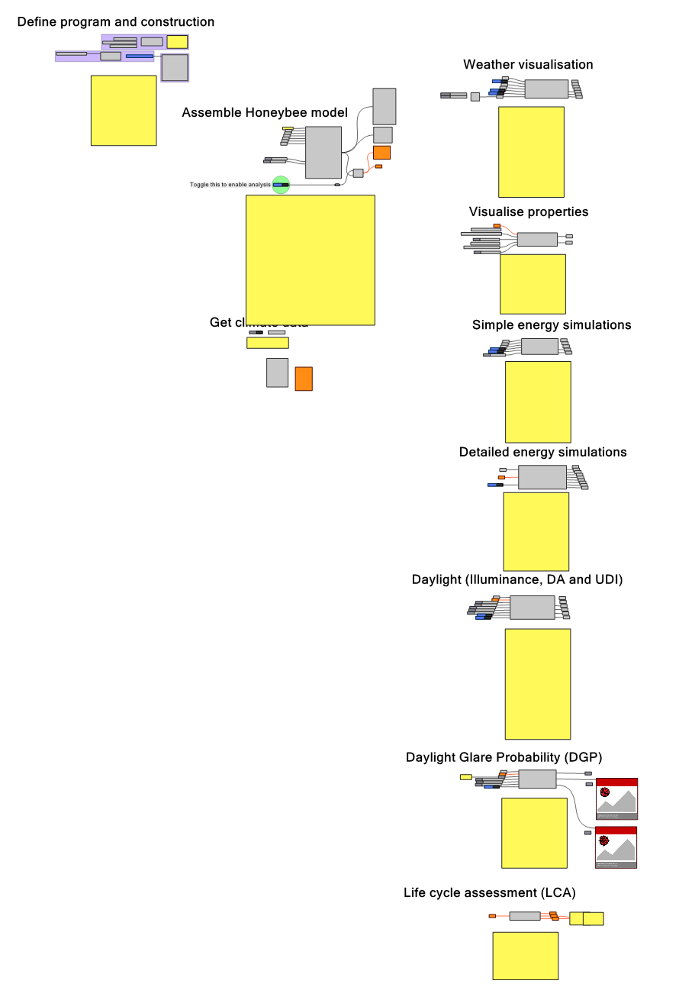

# ACE405 Building Analysis

A Grasshopper teaching workflow for creating a building analysis model and exploring energy, daylight, glare and life cycle assessment (LCA).

The script was developed for ACE405, *Design and performance optimization in architecture*, at Chalmers. This repository preserves the supplied workflow; the migration has not revalidated its simulations.

## Getting started

1. Install **Rhino 7** and **Ladybug Tools 1.6.0**, including OpenStudio and Radiance, as specified in the original documentation.
2. Open [230904ace405_analysis_script.gh](230904ace405_analysis_script.gh) in Grasshopper.
3. Follow the instructions inside the definition to define the building model, obtain climate data and run the required analyses. See [reproduction details and outstanding inputs](docs/reproduce.md).

## Documentation and attribution

- [Workflow, assumptions and limitations](docs/README.md)
- [Input data and provenance](data/README.md)
- [Original documentation](docs/original-readme.md)
- [Migration and retained history](docs/migration.md)
- [Citation metadata](CITATION.cff)

The definition's retained Git history identifies **Toivo Säwén** as its contributor; the original documentation lists him as the support contact at `sawen@chalmers.se`. Additional contributor attribution remains in Git history. Funding and publication records still require project-member confirmation.

Repository code is released under the [MIT License](LICENSE). External software and weather data retain their own terms.
